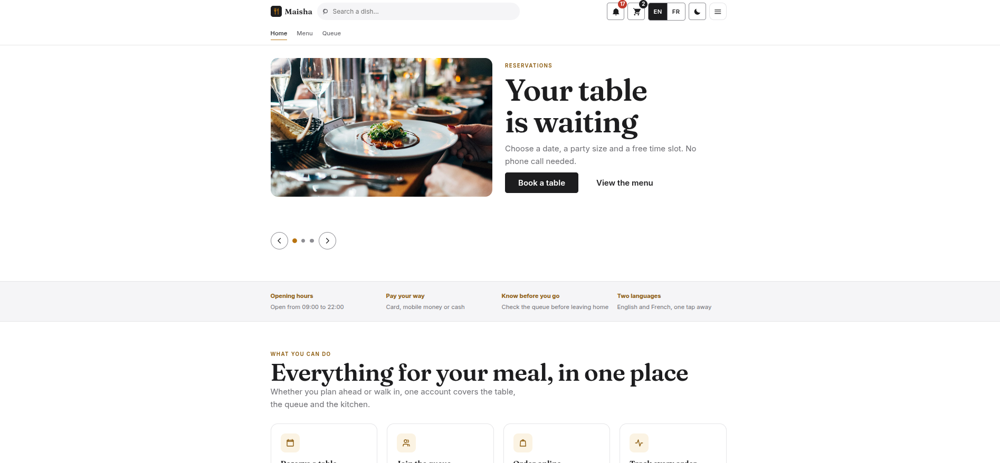

# 🍽️ Restaurant Frontend

<p align="center">
  <strong>A modern restaurant experience for reservations, queue management and online ordering.</strong>
  <br />
  Built with Vue 3 and Vite.
</p>

<p align="center">
  <a href="https://vuejs.org/">
    
  </a>
  <a href="https://vite.dev/">
    
  </a>
  <a href="https://vitest.dev/">
    
  </a>
  
  <a href="LICENSE">
    
  </a>
</p>

---

## Overview

**Restaurant Frontend** is a Vue 3 web application for restaurant customers, staff and administrators. It brings the main dining journey together in one place: exploring the menu, managing a cart, placing online orders, reserving tables and checking the queue.

The frontend communicates with the Django REST API in [`restaurant-backend`](https://github.com/monamijer/restaurant-backend).

## Application Preview

<p align="center">
  
</p>

*Homepage preview of the Restaurant Frontend.*

## Features

- **Digital menu** — browse available dishes.
- **Online ordering** — add items to a cart and proceed through checkout.
- **Table reservations** — choose a date, party size and available time slot.
- **Queue management** — view and manage the customer queue.
- **Staff area** — dedicated tools for restaurant staff.
- **Admin area** — administrative functionality.
- **Bilingual interface** — English and French.
- **Responsive experience** — designed for use across screen sizes.

## Tech Stack

| Technology | Role |
| --- | --- |
| Vue 3.5 | Frontend framework |
| Vite 8 | Development server and build tool |
| Vitest | Test suite |
| ESLint | Code linting |
| Django REST API | Backend integration |

## Getting Started

### Prerequisites

- Node.js 22.13 or later
- npm
- The [restaurant-backend](https://github.com/monamijer/restaurant-backend) API running locally

The backend must allow requests from `http://localhost:5173` through `CORS_ALLOWED_ORIGINS`.

### Installation

1. Clone the repository:

   ```bash
   git clone https://github.com/monamijer/restaurant-frontend.git
   cd restaurant-frontend
   ```

2. Install dependencies:

   ```bash
   npm install
   ```

3. Create your local environment file:

   ```bash
   cp .env.example .env
   ```

   Set `VITE_API_BASE_URL` if the API is not available at `http://localhost:8000/api`.

4. Start the development server:

   ```bash
   npm run dev
   ```

   Open [http://localhost:5173](http://localhost:5173) in your browser.

## Available Scripts

| Command | Description |
| --- | --- |
| `npm run dev` | Start the local development server |
| `npm run build` | Create a production build |
| `npm test` | Run the Vitest test suite |
| `npm run lint` | Run ESLint |

## Demo Accounts

To create the demo accounts, run the following command from the backend project:

```bash
python manage.py seed_demo
```

All demo accounts use the password:

`Demo-Passw0rd!`

| Email | Role |
| --- | --- |
| `admin@demo.example` | Administrator |
| `server@demo.example` | Staff |
| `client1@demo.example` | Customer |

> These credentials are for local development and demonstration only. Do not use them in production.

## Development Conventions

The project follows a consistent set of conventions:

- Vue 3 Options API
- Pinia Options Stores
- No semicolons; single quotes
- No `v-html`
- Mobile-first, scoped CSS built around design tokens
- Matching internationalization keys in English and French

Further technical documentation:

- [Development handoff](docs/HANDOFF.md)
- [Architecture and technical decisions](docs/decisions/)

## Related Repository

- [restaurant-backend](https://github.com/monamijer/restaurant-backend) — Django REST API

## License

Released under the **MIT License**. See the [LICENSE](LICENSE) file for the full terms.

<p align="center">
  <a href="LICENSE" title="Click to view the MIT License">
    
  </a>
  <br />
  <sub>© 2026 Monami Jerome</sub>
</p>
